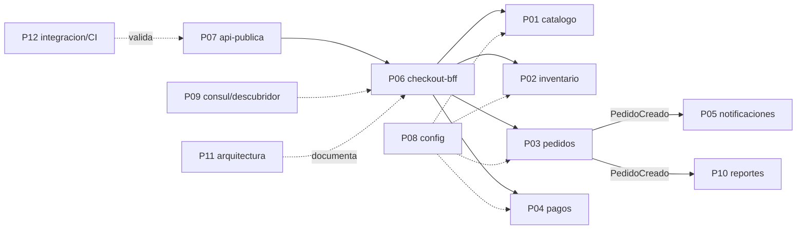

# Los 12 paquetes de trabajo

Cada estudiante recibe **un** paquete mediante la ruleta. Trabaja en su rama `pXX-nombre` y entrega una carpeta propia; los contratos (`docs/CONTRATOS.md`) permiten trabajar en paralelo. Los criterios de aceptación de cada paquete se verifican con `herramientas/validar_entrega.py` y con la sustentación.

| Paquete | Entregable | Semana(s) que evidencia | Indicador |
|---|---|---|---|
| P01 | `services/catalogo-service` | 2 | 1.1 |
| P02 | `services/inventario-service` | 2, 3 | 1.2 |
| P03 | `services/pedidos-service` | 3 | 1.2 |
| P04 | `services/pagos-service` | 2, 3 | 1.1 |
| P05 | `services/notificaciones-service` | 3 | 1.2 |
| P06 | `services/checkout-bff` | 2, 3 | 1.3 |
| P07 | `services/api-publica` | 2 | 1.1 |
| P08 | `services/config-service` | 4 | 1.2 |
| P09 | `services/descubridor-service` + Consul | 4 | 1.2 |
| P10 | `services/reportes-service` | 3 | 1.2 |
| P11 | `docs/arquitectura/` | 1, 2 | 1.4 |
| P12 | `retos/`, `docker-compose.yml`, CI | 3, 4 | 1.2 |

## Acciones de cada participante

### P01 — Catálogo (core)
1. Copiar `plantilla-servicio/` a `services/catalogo-service/`.
2. Separar `models.py` (SQLAlchemy) de `schemas.py` (Pydantic): es la ACL interna de la semana 2.
3. Implementar `repository.py` y el router `/v1/productos` con paginación y los cuatro endpoints del contrato.
4. Validar el contrato con Pydantic (precio > 0, SKU único) y documentarlo en `/docs`.
5. Escribir al menos 6 pruebas `pytest` (200, 201, 404, 409, 422, paginación) y la evidencia con `curl` en el README.
6. Cargar una semilla de 10 productos que se pueda reiniciar.

### P02 — Inventario (core)
1. Copiar la plantilla a `services/inventario-service/`.
2. Modelar `stock` y `reservas` en su propia base.
3. Implementar `POST /v1/reservas` con `Idempotency-Key`: la misma clave devuelve la misma respuesta y no descuenta dos veces.
4. Implementar la compensación `liberar` (idempotente) y el `409` por stock insuficiente.
5. Evitar la condición de carrera (dos reservas simultáneas por la última unidad) con transacción o bloqueo; demostrarlo con una prueba concurrente.
6. README con la evidencia y una nota de qué eje del cubo de escalabilidad aplicaría a este servicio y por qué.

### P03 — Pedidos con Outbox (core)
1. Copiar la plantilla a `services/pedidos-service/`.
2. Modelar `pedidos` y `outbox`; `POST /v1/pedidos` guarda **ambos en una sola transacción**, sin llamadas de red dentro de ella.
3. Implementar el publicador en segundo plano (outbox → `pishop.pedidos`) con marca `publicado_en`; soportar `PISHOP_EVENT_BUS=memory`.
4. Implementar `cancelar` y el evento `PedidoCancelado`.
5. Prueba que demuestre at-least-once: matar el publicador entre publicar y marcar, y mostrar el reenvío.
6. Documentar por qué el patrón no da exactly-once y qué lo complementa.

### P04 — Pagos con ACL (core)
1. Copiar la plantilla a `services/pagos-service/`.
2. Implementar la pasarela simulada con los cuatro modos (`ok`, `rechaza`, `lenta`, `falla`).
3. Escribir el adaptador ACL: traduce el vocabulario de la pasarela al dominio (`APROBADO`/`RECHAZADO`/`PENDIENTE`).
4. Cliente `httpx.AsyncClient` único por proceso y con timeout explícito; pasarela lenta ⇒ responde error en menos del timeout.
5. `Idempotency-Key` en `POST /v1/pagos` y reembolso idempotente.
6. Pruebas de los cuatro modos y evidencia en el README.

### P05 — Notificaciones (consumidor asíncrono)
1. Copiar la plantilla a `services/notificaciones-service/`.
2. Implementar el consumidor con grupo `notificaciones` (Redis Streams) y un bus en memoria para pruebas.
3. Deduplicar por `evento_id` (idempotencia): el mismo evento dos veces genera una sola notificación.
4. Exponer `GET /v1/notificaciones` y `POST /v1/notificaciones/prueba`.
5. `/health/ready` depende del estado del bus; `/health/live` no.
6. Prueba que reproduzca el evento duplicado de la demo de la semana 3 (`[dup] ... se descarta`).

### P06 — Checkout BFF (compuesto, saga)
1. Copiar la plantilla a `services/checkout-bff/`.
2. Implementar `POST /v1/checkout` como **saga por orquestación** con los cuatro pasos y sus compensaciones.
3. Un `AsyncClient` por proceso con timeouts por servicio; fallo parcial ⇒ compensar y responder `FALLIDO` con el detalle de pasos.
4. `Idempotency-Key`: repetir el checkout no crea otro pedido.
5. `GET /v1/vitrina` agrega catálogo + inventario con solo los campos que necesita el móvil.
6. Pruebas con dobles de los servicios core (sin depender de los compañeros) para éxito y para fallo en cada paso.

### P07 — API pública (fachada)
1. Copiar la plantilla a `services/api-publica/`.
2. Autenticación por `X-API-Key` (secreto en settings) → `401`.
3. Límite de tasa de 60/min por clave → `429` + `Retry-After`.
4. Enrutar a `checkout-bff` y `catalogo-service`; mostrar solo productos publicados.
5. Errores `problem+json`; **cero** lógica de negocio (el gateway enruta, el BFF agrega).
6. Pruebas de `401`, `429` y enrutamiento, con dobles de los servicios internos.

### P08 — Config service
1. Copiar la plantilla a `services/config-service/` (puerto 8010).
2. Implementar versionado en memoria o SQLite con historial (autor, motivo, fecha).
3. `ETag` y `If-None-Match` → `304`; versión histórica con `?version=N`; `rollback`.
4. Exigir `X-Autor` en `PUT` (auditoría).
5. Cargar `seed.json` con la configuración de los 7 servicios en los 4 entornos (dev/qa/stg/prod).
6. Escribir `config_client.py` reutilizable (polling cada 15 s, `ETag`, tolerancia a fallo, arranca con defaults si el servidor está caído) y probarlo.

### P09 — Registro y descubrimiento
1. Copiar la plantilla a `services/descubridor-service/` (puerto 8090).
2. Levantar Consul 1.21 en compose y escribir `registro.py` con `registrar()`/`dar_de_baja()` para el `lifespan`.
3. Implementar `/v1/servicios`, `/instancias` (solo `passing`) y `/resolver` (round-robin).
4. Probar con 3 réplicas de un servicio: las 3 en `passing` en menos de 30 s; detener una y que deje de resolverse en menos de 30 s.
5. Escribir `docs/descubrimiento.md`: cliente vs servidor, ventajas y desventajas, decisión para PiShop.
6. Evidencia (capturas de la UI de Consul y salida de `curl`).

### P10 — Reportes (CQRS)
1. Copiar la plantilla a `services/reportes-service/` (puerto 8006).
2. Consumidor del grupo `reportes` con proyección idempotente (por `evento_id`).
3. `GET /v1/reportes/resumen` y `ventas-por-sku`; `PedidoCancelado` descuenta de la proyección.
4. `POST /v1/reportes/reconstruir` rehace la proyección desde cero.
5. Probar que reprocesar el mismo evento no altera los totales.
6. README: por qué esto es CQRS y qué consistencia ofrece (eventual) frente a la escritura.

### P11 — Arquitecto (documentación como código)
1. Crear `docs/arquitectura/arquitectura-objetivo.md` con el contexto del negocio y los requerimientos (indicador 1.3).
2. C4 nivel 1 y nivel 2 en **PlantUML** (código fuente versionado, más imágenes renderizadas).
3. Tabla de subdominios (core/soporte/genérico) y **context map** en Mermaid con al menos tres patrones de relación y una ACL justificada.
4. Matriz de atributos de calidad ISO/IEC 25010 priorizada y tres ADR (decisión, alternativa descartada, trade-off).
5. Diagramas UML de secuencia del checkout (síncrono vs asíncrono diferenciados), de la saga (Mermaid) y de despliegue.
6. Matriz de modos de comunicación (par de servicios, modo, protocolo, qué pasa si el destino cae) y `herramientas/validar_fronteras.py` como *fitness function* (falla si dos servicios comparten base de datos).

### P12 — Confiabilidad, integración y CI
1. `retos/semana03/disponibilidad.py`: disponibilidad compuesta en serie y paralelo de la ruta crítica (valores del reto 3.1), caída en horas/año y tabla antes/después con tres mitigaciones, una de ellas pasando un paso a asíncrono.
2. `docker-compose.yml` que levante los 10 servicios, PostgreSQL 17, Redis 8 y Consul con `docker compose up -d`.
3. Prueba de extremo a extremo `retos/e2e.sh` o `e2e.py`: compra feliz y compra con pago rechazado (verifica compensaciones).
4. Flujo de CI en GitHub Actions que ejecute `validar_entrega.py --todos` y `pytest` por servicio.
5. `herramientas/auditar_config.py` (criterio 1 del reto 4.1: ningún `password|secret|api_key|http://<ip>` en el código).
6. Verificar que la disponibilidad real y las sondas cumplen los criterios 2 y 3 del reto 4.1 en cada servicio y reportar incumplimientos como *issues*.

## Dependencias entre paquetes (para negociar, no para esperar)

